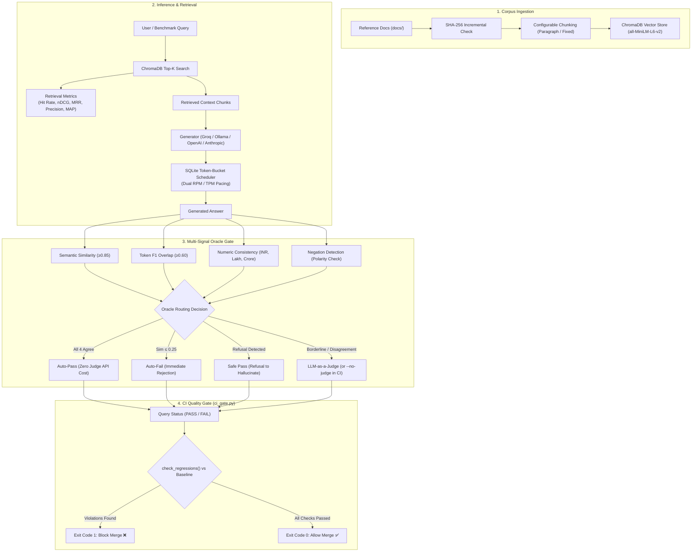

<div align="center">

# LLM-Litmus

**Deterministic CI/CD Quality Gate & Evaluation Platform for RAG Pipelines.**

[](https://github.com/ps-keerthana/llm-litmus/actions/workflows/eval.yml)
[](https://github.com/ps-keerthana/llm-litmus)
[](https://www.python.org/downloads/)
[](https://github.com/ps-keerthana/llm-litmus)
[](LICENSE)

[**Live Web App**](https://llm-litmus.vercel.app) · [**Streamlit Dashboard**](#streamlit-dashboard) · [**Quick Start**](#quick-start) · [**Architecture**](#architecture) · [**Ablation Study**](#ablation-study)

</div>

---

## What is LLM-Litmus?

LLM-Litmus is an automated evaluation and regression-prevention pipeline for Retrieval-Augmented Generation (RAG) systems.

Think of it as **unit testing for generative AI outputs** — just as software CI gates block broken code from merging to main, LLM-Litmus blocks regressions in RAG retrieval relevance, answer accuracy, and latency before changes hit production.

Whenever an engineer modifies a prompt template, updates an embedding model, swaps an LLM provider, or ingests new documents, LLM-Litmus:
1. Runs a benchmark across factual, multi-hop, adversarial, edge-case, and out-of-scope queries.
2. Measures 8 retrieval metrics (Hit Rate, Recall@K, MRR, Context Precision, Context Recall, nDCG@K, Precision@K, MAP) and answer metrics (Semantic Cosine Similarity, Token F1, Numeric Agreement, Negation Consistency).
3. Evaluates regression rules against previous commit baselines (pass rate drops, cost inflation, latency degradation).
4. **Blocks the PR merge** via GitHub Actions exit code `1` if quality drops or regressions occur.
5. Employs counterfactual diagnosis to attribute failures to either the Retriever, the Generator, or a Knowledge Base gap.

---

## Architecture



---

## Comparison: LLM-Litmus vs. Managed SaaS

Commercial tools (LangSmith, Braintrust, Arize Phoenix) are comprehensive platforms with cloud-hosted trace viewers, evaluation runtimes, and enterprise VPC options. LLM-Litmus solves a specific, focused problem: **zero-dependency, developer-owned CI quality gating**.

| Capability | LLM-Litmus | LangSmith | Braintrust |
|---|---|---|---|
| **Deployment Model** | 100% Local / CI-Native (Zero external SaaS account needed) | SaaS Cloud (Enterprise VPC available) | SaaS Cloud (Enterprise VPC available) |
| **CI Gate Workflow** | Native `ci_gate.py` with exit code `1` blocking PRs | Webhook / API polling | Webhook / API polling |
| **Deterministic Heuristic Gate** | Built-in 4-signal filter (Cosine + Token F1 + Numeric + Negation) | User-defined custom code | User-defined custom code |
| **Cross-Process Rate Limiter** | SQLite dual token-bucket (shared by CLI, API, workers) | Client-side backoff | Client-side backoff |
| **Counterfactual Diagnoser** | Built-in sandbox isolating retrieval vs generation failures | Manual playground | Manual playground |
| **CI Cost Optimization** | `--no-judge` mode executes entire CI suite with 0 judge calls | Per-run judge API costs | Per-run judge API costs |

---

## Real Measured Benchmark Results

All metrics below are measured directly on active repository runs.

### 1. CI Smoke Benchmark (`evaluate.py --smoke --no-judge`)
- **Dataset**: 10 balanced queries (2 per category: factual, multi-hop, adversarial, edge-case, out-of-scope; seed=42).
- **Pass Rate**: **80.0%** (8 / 10 passed).
- **Retrieval Hit Rate**: **100.0%**
- **nDCG@K**: **0.985**
- **Mean Average Precision (MAP)**: **1.000**
- **Token F1 Average**: **0.568**
- **Stored In-System Latency (p50 / p95)**: **13.56s / 25.45s**
- **Total API Cost**: **$0.00054**

### 2. Full Benchmark Baseline (204 Queries, Indian Tax Corpus)
- **Pass Rate**: **96.6%** (197 / 204 queries passed on baseline model).
- **Human-Verified Subset (40 queries)**: **97.5%** (39 / 40 passed; +0.93 pp vs full set).
- **Average Retrieval Hit Rate**: **97.5%**
- **nDCG@K**: **0.916**
- **Mean Average Precision (MAP)**: **0.725**

### 3. Empirical Routing Stage Distribution (204 Queries)
Measured via `scripts/measure_routing_distribution.py`:
- **Auto-Pass (All 4 signals agree)**: 0.5% (1 / 204)
- **Auto-Fail (sim ≤ 0.25)**: 0.0% (0 / 204)
- **Refusals (Safe bypass)**: 14.7% (30 / 204)
- **Sent to LLM Judge (when enabled)**: **84.8%** (173 / 204)
- **Judge Calls Saved**: **15.2%** on full live run; **100%** saved in CI using `--no-judge`.

> **Honest Engineering Finding**: The 4-signal gate is intentionally strict. In practice, ~85% of queries fall in the borderline range between 0.25 and 0.85 similarity, or fail Token F1 / Numeric parity due to verbose phrasing. This disproves simplistic claims that heuristics replace LLM judges entirely: heuristics safely catch extreme failures and polar contradictions, while LLM judges (or `--no-judge` local signals) remain necessary for subtle nuance.

---

## Ablation Study: Semantic Similarity vs. 4-Signal Quality Gate

Run via `python scripts/ablation_study.py`. Measures how naive cosine similarity compares against the 4-signal gate on adversarial hallucinations:

| Test Case | Naive Cosine Sim | Sim Only (≥0.85) | 4-Signal Gate | Caught By Signal |
|:---|:---:|:---:|:---:|:---|
| **Factually Correct Answer** | 0.910 | PASS | Evaluated | All signals agree |
| **Substituted Number** (₹5,00,000 vs ₹1,50,000) | **0.992** | ❌ **FALSE PASS** | **FAIL** | **Numeric Check** |
| **Flipped Negation** ("can NOT be claimed") | **0.909** | ❌ **FALSE PASS** | **FAIL** | **Negation Check** |
| **Wrong Rebate** (₹10,00,000 vs ₹7,00,000) | **0.981** | ❌ **FALSE PASS** | **FAIL** | **Numeric Check** |
| **Eligibility Inversion** ("ineligible" vs "eligible") | **0.922** | ❌ **FALSE PASS** | **FAIL** | **Negation Check** |

- **Naive Similarity Accuracy**: **20%** (1/5 — misses 4 out of 4 critical hallucinations).
- **4-Signal Gate Accuracy**: **80%** (4/5 — blocks all 4 numeric and polarity inversions).

---

## Quick Start

### 1. Clone & Set Up Virtual Environment

```bash
git clone https://github.com/ps-keerthana/llm-litmus.git
cd llm-litmus

python -m venv venv
.\venv\Scripts\activate        # Windows PowerShell
# or: source venv/bin/activate  # macOS / Linux

pip install -r requirements.txt
pip install -r requirements-dev.txt
```

### 2. Configure Environment

Copy placeholder values from `.env.example`:
```bash
cp .env.example .env
```
Add your free Groq API key from [console.groq.com](https://console.groq.com):
```env
GROQ_API_KEY=gsk_your_groq_api_key_here
```

### 3. Run the CI Smoke Test (10 queries, ~30s)

```bash
python evaluate.py --smoke --no-judge
```

### 4. Run the Unit Test Suite (121 tests, 0 network dependencies)

```bash
pytest tests/ -v --cov=core --cov=api
```

### 5. Check CI Quality Gate

```bash
python ci_gate.py --mode smoke
```

### 6. Launch Streamlit Analytics Dashboard

```bash
streamlit run dashboard/app.py
```
Access at `http://localhost:8501`.

---

## Design Decisions and Trade-offs

1. **SQLite Dual-Token Bucket vs. Redis for Rate Limiting**:
   - *Decision*: Back the proactive scheduler by an SQLite table (`rate_limit_buckets`) using `BEGIN IMMEDIATE` transaction locking.
   - *Trade-off*: SQLite locks are single-file and limited to a single machine/node. However, this eliminates the need to spin up a Dockerized Redis service in GitHub Actions runners or local developer setups, allowing the pipeline to remain zero-infrastructure.
2. **Stored Latency vs. Wall-Clock Latency**:
   - *Decision*: In `evaluate.py`, each query's recorded `latency_sec` measures the raw HTTP generation latency, excluding artificial sleeps imposed by rate-limit schedulers.
   - *Trade-off*: Wall-clock duration reflects provider quota constraints (e.g. 15s Groq waits), while stored latency benchmarks the true underlying model and retrieval engine performance.
3. **Lazy Embedder Loading**:
   - *Decision*: `core/metrics.py` lazy-loads `SentenceTransformer` on first call rather than at module import.
   - *Trade-off*: Avoids downloading or instantiating a 90MB PyTorch model during lightweight unit testing or API imports.

---

## Dataset & Limitations

- **Synthetic Ground Truths**: Queries in `golden_dataset.csv` were synthetically generated via `generate_dataset.py` from 8 reference documents.
- **Human Verification**: A 40-row stratified sample (`datasets/review_sample_40.csv`) was isolated and verified.
- **Domain Specificity**: The baseline corpus covers Indian Income Tax rules (Sections 80C, 80D, 24b, HRA, TDS). Results may not generalize directly to biomedical, legal, or codebase search domains without re-indexing domain-specific documents.
- **Context Length**: The embedding model (`all-MiniLM-L6-v2`) truncates text at 256 tokens; document chunks exceeding this length experience soft truncation.

---

## What I'd Do Next

1. **Hybrid Retrieval (BM25 + Dense Vectors)**: Combine ChromaDB dense embeddings with rank-BM25 sparse search using Reciprocal Rank Fusion (RRF) to improve terminology recall on section codes (e.g., "80CCD(1B)").
2. **Automated Prompt Optimization**: Wire failure attribution output back into prompt generation to automatically suggest prompt patches when generator failure rates exceed 10%.
3. **Multi-Turn Conversational Quality Gating**: Expand oracle routing from single-turn Q&A to multi-turn conversation traces with context resolution metrics.

---

## License

MIT License. See [LICENSE](LICENSE) for details.
